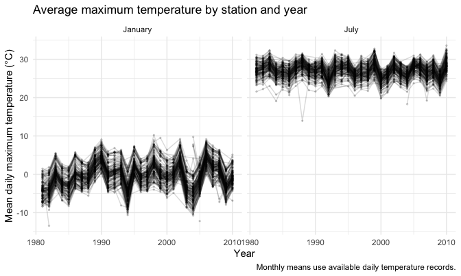
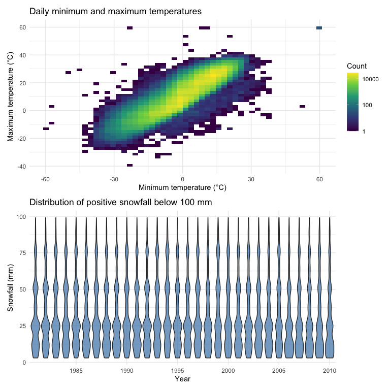
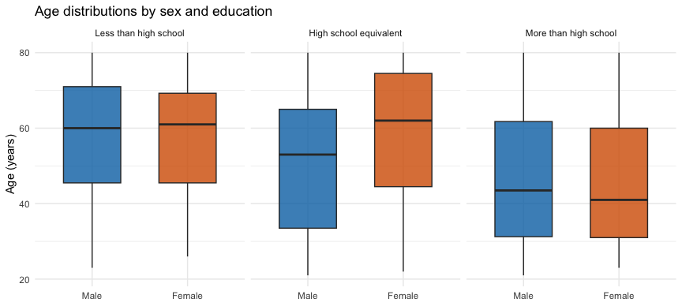
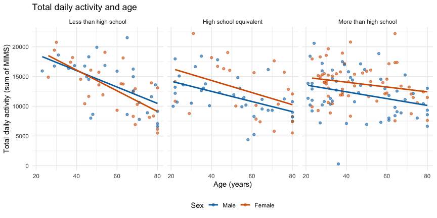
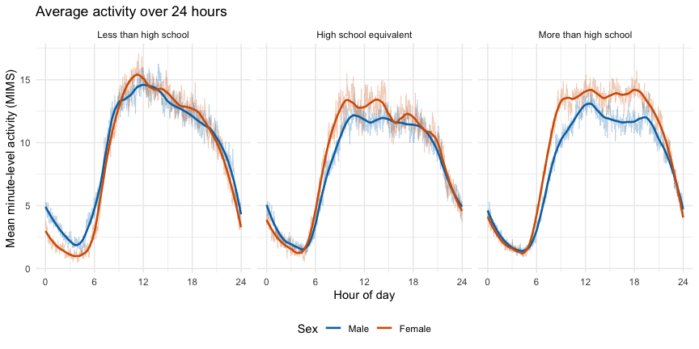

P8105 Homework 3
================
Xueying Jia

# Problem 1

## Import and inspect the data

``` r
data("ny_noaa")

dim(ny_noaa)
```

    ## [1] 2595176       7

``` r
glimpse(ny_noaa)
```

    ## Rows: 2,595,176
    ## Columns: 7
    ## $ id   <chr> "US1NYAB0001", "US1NYAB0001", "US1NYAB0001", "US1NYAB0001", "US1N…
    ## $ date <date> 2007-11-01, 2007-11-02, 2007-11-03, 2007-11-04, 2007-11-05, 2007…
    ## $ prcp <int> NA, NA, NA, NA, NA, NA, NA, NA, NA, NA, NA, NA, NA, NA, NA, NA, 3…
    ## $ snow <int> NA, NA, NA, NA, NA, NA, NA, NA, NA, NA, NA, NA, NA, NA, NA, NA, 3…
    ## $ snwd <int> NA, NA, NA, NA, NA, NA, NA, NA, NA, NA, NA, NA, NA, NA, NA, NA, 0…
    ## $ tmax <chr> NA, NA, NA, NA, NA, NA, NA, NA, NA, NA, NA, NA, NA, NA, NA, NA, N…
    ## $ tmin <chr> NA, NA, NA, NA, NA, NA, NA, NA, NA, NA, NA, NA, NA, NA, NA, NA, N…

The original dataset contains 2,595,176 daily weather records from 747
stations in New York State, covering 1981–2010. Each row represents one
station on one date. Variables include precipitation, snowfall, snow
depth, and daily maximum and minimum temperatures. Missingness varies
across variables: approximately 5.6% for precipitation, 14.7% for
snowfall, 22.8% for snow depth, and 43.7% for each temperature variable.

I extracted year, month, and day from the date. I converted the
temperature variables from character to numeric and expressed
temperatures in degrees Celsius and precipitation in millimeters.
Snowfall and snow depth were already recorded in millimeters.

``` r
ny_noaa |>
  summarize(
    n_stations = n_distinct(id),
    first_date = min(date),
    last_date = max(date)
  )
```

    ## # A tibble: 1 × 3
    ##   n_stations first_date last_date 
    ##        <int> <date>     <date>    
    ## 1        747 1981-01-01 2010-12-31

``` r
ny_noaa |>
  summarize(
    prcp_missing_pct = mean(is.na(prcp)) * 100,
    snow_missing_pct = mean(is.na(snow)) * 100,
    snwd_missing_pct = mean(is.na(snwd)) * 100,
    tmax_missing_pct = mean(is.na(tmax)) * 100,
    tmin_missing_pct = mean(is.na(tmin)) * 100
  )
```

    ## # A tibble: 1 × 5
    ##   prcp_missing_pct snow_missing_pct snwd_missing_pct tmax_missing_pct
    ##              <dbl>            <dbl>            <dbl>            <dbl>
    ## 1             5.62             14.7             22.8             43.7
    ## # ℹ 1 more variable: tmin_missing_pct <dbl>

``` r
noaa_df =
  ny_noaa |>
  mutate(
    year = lubridate::year(date),
    month = lubridate::month(date),
    day = lubridate::day(date),
    tmax = as.numeric(tmax) / 10,
    tmin = as.numeric(tmin) / 10,
    prcp = prcp / 10
  )

dim(noaa_df)
```

    ## [1] 2595176      10

``` r
glimpse(noaa_df)
```

    ## Rows: 2,595,176
    ## Columns: 10
    ## $ id    <chr> "US1NYAB0001", "US1NYAB0001", "US1NYAB0001", "US1NYAB0001", "US1…
    ## $ date  <date> 2007-11-01, 2007-11-02, 2007-11-03, 2007-11-04, 2007-11-05, 200…
    ## $ prcp  <dbl> NA, NA, NA, NA, NA, NA, NA, NA, NA, NA, NA, NA, NA, NA, NA, NA, …
    ## $ snow  <int> NA, NA, NA, NA, NA, NA, NA, NA, NA, NA, NA, NA, NA, NA, NA, NA, …
    ## $ snwd  <int> NA, NA, NA, NA, NA, NA, NA, NA, NA, NA, NA, NA, NA, NA, NA, NA, …
    ## $ tmax  <dbl> NA, NA, NA, NA, NA, NA, NA, NA, NA, NA, NA, NA, NA, NA, NA, NA, …
    ## $ tmin  <dbl> NA, NA, NA, NA, NA, NA, NA, NA, NA, NA, NA, NA, NA, NA, NA, NA, …
    ## $ year  <dbl> 2007, 2007, 2007, 2007, 2007, 2007, 2007, 2007, 2007, 2007, 2007…
    ## $ month <dbl> 11, 11, 11, 11, 11, 11, 11, 11, 11, 11, 11, 11, 11, 11, 11, 11, …
    ## $ day   <int> 1, 2, 3, 4, 5, 6, 7, 8, 9, 10, 11, 12, 13, 14, 15, 16, 17, 18, 1…

``` r
noaa_df |>
  filter(!is.na(snow)) |>
  count(snow, sort = TRUE) |>
  slice_head(n = 10) |>
  knitr::kable(
    col.names = c("Snowfall (mm)", "Number of observations")
  )
```

| Snowfall (mm) | Number of observations |
|--------------:|-----------------------:|
|             0 |                2008508 |
|            25 |                  31022 |
|            13 |                  23095 |
|            51 |                  18274 |
|            76 |                  10173 |
|             8 |                   9962 |
|             5 |                   9748 |
|            38 |                   9197 |
|             3 |                   8790 |
|           102 |                   6552 |

Zero is the most common snowfall value, reflecting the many station-days
without snowfall. Common positive values include 25, 13, 51, and 76 mm.
These values are close to common inch increments, suggesting that unit
conversion and rounding may contribute to the observed pattern.

``` r
monthly_temp_df =
  noaa_df |>
  filter(
    month %in% c(1, 7),
    !is.na(tmax)
  ) |>
  group_by(id, year, month) |>
  summarize(
    mean_tmax = mean(tmax),
    n_days = n(),
    .groups = "drop"
  ) |>
  mutate(
    month = factor(
      month,
      levels = c(1, 7),
      labels = c("January", "July")
    )
  )

head(monthly_temp_df)
```

    ## # A tibble: 6 × 5
    ##   id           year month   mean_tmax n_days
    ##   <chr>       <dbl> <fct>       <dbl>  <int>
    ## 1 USC00300023  1981 January     -3.17     23
    ## 2 USC00300023  1981 July        28.3      22
    ## 3 USC00300023  1982 January     -4.32     27
    ## 4 USC00300023  1982 July        27.8      31
    ## 5 USC00300023  1983 January      1.11     31
    ## 6 USC00300023  1983 July        29.8      31

``` r
monthly_temp_df |>
  ggplot(
    aes(
      x = year,
      y = mean_tmax,
      group = id
    )
  ) +
  geom_line(alpha = 0.15) +
  geom_point(alpha = 0.15, size = 0.5) +
  facet_grid(. ~ month) +
  labs(
    title = "Average maximum temperature by station and year",
    x = "Year",
    y = "Mean daily maximum temperature (°C)",
    caption = "Monthly means use available daily temperature records."
  )
```



Average maximum temperatures are much higher in July than in January.
Temperatures vary across stations, and many stations show similar
year-to-year changes. January shows larger year-to-year fluctuations.
Station USC00308962 has an unusually low mean maximum temperature of
about 14.0°C in July 1988. This mean is based on 31 daily records, so it
is not explained by a small number of observed days. The underlying
measurements should be checked before interpreting this value.

``` r
temp_plot =
  noaa_df |>
  filter(
    !is.na(tmin),
    !is.na(tmax)
  ) |>
  ggplot(aes(x = tmin, y = tmax)) +
  geom_bin2d(bins = 50) +
  scale_fill_viridis_c(
    trans = "log10",
    name = "Count"
  ) +
  labs(
    title = "Daily minimum and maximum temperatures",
    x = "Minimum temperature (°C)",
    y = "Maximum temperature (°C)"
  )
```

``` r
snow_plot =
  noaa_df |>
  filter(
    snow > 0,
    snow < 100
  ) |>
  ggplot(aes(x = factor(year), y = snow)) +
  geom_violin(
    fill = "steelblue",
    alpha = 0.7
  ) +
  scale_x_discrete(
    breaks = as.character(seq(1985, 2010, by = 5))
  ) +
  labs(
    title = "Distribution of positive snowfall below 100 mm",
    x = "Year",
    y = "Snowfall (mm)"
  )
```

``` r
temp_plot / snow_plot
```



Daily minimum and maximum temperatures show a strong positive
association: days with higher minimum temperatures generally also have
higher maximum temperatures. The two-dimensional bin plot shows where
observations are concentrated without excessive overlap. A few isolated
extreme values may indicate data quality issues and should be checked.
Among records with snowfall greater than 0 and less than 100 mm, smaller
snowfall amounts are more common. The distributions have similar shapes
across years, with concentrations near 25, 50, and 75 mm. There is no
obvious consistent shift over time in these selected snowfall
distributions. This plot does not compare annual snowfall totals.

# Problem 2

## Data cleaning and merging

``` r
nhanes_covar =
  read_csv(
    "data/nhanes_covar.csv",
    skip = 4,
    show_col_types = FALSE
  ) |>
  rename(
    seqn = SEQN,
    bmi = BMI
  ) |>
  filter(age >= 21) |>
  drop_na(sex, age, bmi, education) |>
  mutate(
    seqn = as.character(seqn),
    sex = factor(
      sex,
      levels = c(1, 2),
      labels = c("Male", "Female")
    ),
    education = factor(
      education,
      levels = c(1, 2, 3),
      labels = c(
        "Less than high school",
        "High school equivalent",
        "More than high school"
      )
    )
  )

dim(nhanes_covar)
```

    ## [1] 228   5

``` r
nhanes_accel_long =
  read_csv(
    "data/nhanes_accel.csv",
    show_col_types = FALSE
  ) |>
  rename(seqn = SEQN) |>
  mutate(seqn = as.character(seqn)) |>
  pivot_longer(
    cols = starts_with("min"),
    names_to = "minute",
    names_prefix = "min",
    values_to = "mims"
  ) |>
  mutate(minute = as.integer(minute))

nhanes_df =
  nhanes_covar |>
  left_join(nhanes_accel_long, by = "seqn")

dim(nhanes_df)
```

    ## [1] 328320      7

``` r
nhanes_df |>
  summarize(
    n_participants = n_distinct(seqn),
    missing_mims = sum(is.na(mims))
  )
```

    ## # A tibble: 1 × 2
    ##   n_participants missing_mims
    ##            <int>        <int>
    ## 1            228            0

Among records with snowfall greater than 0 and less than 100 mm, smaller
snowfall amounts are more common. The distributions have similar shapes
across years, with concentrations near 25, 50, and 75 mm. There is no
obvious consistent shift over time in these selected snowfall
distributions. This plot does not compare annual snowfall totals.

## Participants by education and sex

``` r
nhanes_covar |>
  count(education, sex) |>
  pivot_wider(
    names_from = sex,
    values_from = n,
    values_fill = 0
  ) |>
  knitr::kable(
    col.names = c("Education level", "Male", "Female")
  )
```

| Education level        | Male | Female |
|:-----------------------|-----:|-------:|
| Less than high school  |   27 |     28 |
| High school equivalent |   35 |     23 |
| More than high school  |   56 |     59 |

## Age distributions

``` r
nhanes_covar |>
  ggplot(aes(x = sex, y = age, fill = sex)) +
  geom_boxplot(width = 0.6, alpha = 0.8) +
  facet_wrap(~ education, nrow = 1) +
  scale_fill_manual(
    values = c("Male" = "#0072B2", "Female" = "#D55E00")
  ) +
  labs(
    title = "Age distributions by sex and education",
    x = NULL,
    y = "Age (years)"
  ) +
  theme(legend.position = "none")
```


The largest education category is more than high school, with 115
participants. Numbers of men and women are similar in the lowest and
highest education categories, whereas the high school equivalent group
includes more men than women (35 versus 23).

Participants with more than high school education have lower median
ages: 43.5 years for men and 41 years for women. In the high school
equivalent group, women have a higher median age than men (62 versus 53
years). Median ages are similar for men and women with less than high
school education (60 and 61 years). \## Total daily activity and age

``` r
nhanes_total =
  nhanes_df |>
  group_by(seqn, sex, age, education) |>
  summarize(
    total_activity = sum(mims),
    .groups = "drop"
  )

nhanes_total |>
  ggplot(aes(x = age, y = total_activity, color = sex)) +
  geom_point(alpha = 0.6, size = 1.5) +
  geom_smooth(method = "lm", se = FALSE) +
  facet_wrap(~ education, nrow = 1) +
  scale_color_manual(
    values = c("Male" = "#0072B2", "Female" = "#D55E00")
  ) +
  labs(
    title = "Total daily activity and age",
    x = "Age (years)",
    y = "Total daily activity (sum of MIMS)",
    color = "Sex"
  ) +
  theme(legend.position = "bottom")
```


Total daily activity tends to decrease with age for both men and women
within each education category. There is substantial individual
variability and overlap between the sexes. The fitted trends differ
across education groups, but these descriptive associations do not
establish causal effects of age, sex, or education on activity.

## Activity patterns over 24 hours

``` r
nhanes_time =
  nhanes_df |>
  group_by(education, sex, minute) |>
  summarize(
    mean_mims = mean(mims),
    .groups = "drop"
  ) |>
  mutate(
    hour = (minute - 1) / 60
  )

nhanes_time |>
  ggplot(aes(x = hour, y = mean_mims, color = sex)) +
  geom_line(alpha = 0.3, linewidth = 0.3) +
  geom_smooth(
    method = "loess",
    span = 0.2,
    se = FALSE,
    linewidth = 0.9
  ) +
  facet_wrap(~ education, nrow = 1) +
  scale_x_continuous(
    breaks = seq(0, 24, by = 6),
    limits = c(0, 24)
  ) +
  scale_color_manual(
    values = c("Male" = "#0072B2", "Female" = "#D55E00")
  ) +
  labs(
    title = "Average activity over 24 hours",
    x = "Hour of day",
    y = "Mean minute-level activity (MIMS)",
    color = "Sex"
  ) +
  theme(legend.position = "bottom")
```


Across all education groups, average activity is lowest overnight,
increases in the morning, remains elevated during the day, and declines
in the late evening. Among participants with more than high school
education, women generally have higher daytime activity than men. Sex
differences are smaller and vary over the day in the other education
groups. These group averages are not adjusted for differences in age or
other characteristics.
